# Alkame NIFTY 50: Institutional Market Intelligence Platform

<div align="center">


### *Enterprise-Grade Real-Time Market Analytics, Volume Radar, Multi-Source Ingestion & Applied Quantitative Academy*

[Core Offerings](#-what-we-offer) • [Platform Capabilities](#-core-platform-capabilities) • [The Academy Course](#-the-academy--quantitative-course-add-on) • [Interactive Frontends](#-interactive-frontends) • [API Guide](#-rest-api-reference) • [Quickstart](#-hands-on-quickstart) • [SEBI Compliance](#-statutory-sebi-compliance-notice)

---

</div>

> [!IMPORTANT]
> ### ⚖️ Statutory Legal & Non-Advisory Notice
> **Alkame-Nifty50 is an institutional market intelligence, quantitative analytics, and educational research platform.**  
> In compliance with **SEBI (Research Analysts) Regulations, 2014** and **SEBI (Investment Advisers) Regulations, 2013**:
> - Alkame-Nifty50 **does NOT** provide investment advice, trading tips, or financial recommendations.
> - Alkame-Nifty50 **does NOT** issue directional `BUY` or `SELL` trade calls, target prices, or algorithmic stop-loss recommendations.
> - All outputs, visual corridors, pivot levels, and technical indicators are mathematical computations derived purely from publicly available historical data and regulatory filings.
> - Any directional predictive modeling or machine learning weight sets are strictly quarantined locally for offline computational research (`_local_research/`) and are never distributed or served publicly.

---

## 🌟 What We Offer

Alkame delivers a dual-tier solution designed for institutional market analysts, quantitative researchers, FinTech developers, and financial students:

```mermaid
flowchart LR
    subgraph CorePlatform["<b>CORE OFFERING: Market Intelligence Platform</b>"]
        direction TB
        P1["<b>Real-Time Market Intelligence</b><br/>Vectorized technicals, RSI-14, 20/50/200 EMAs, Bollinger, ATR"]
        P2["<b>Intraday Volume & Momentum Radar</b><br/>Universe 50-constituent sweep, volume surge >1.5x"]
        P3["<b>Mathematical Reference Channels</b><br/>Camarilla H3/H4/L3/L4 pivots & classical floor levels"]
        P4["<b>Multi-Source Regulatory Ingestion</b><br/>NSE corporate announcements, board actions, results"]
        P5["<b>Global Macro Contagion Monitor</b><br/>Cross-asset sensitivity: India VIX, Brent Crude, USD/INR"]
        P6["<b>Triple-Frontend Architecture</b><br/>Institutional HTML Cockpit, React 19 SPA, Streamlit Studio"]
    end

    subgraph AddonAcademy["<b>ADD-ON OFFERING: Quantitative Academy & Course</b>"]
        direction TB
        C1["<b>Applied 6-Module Curriculum</b><br/>Microstructure, vectorization, breadth scanners, UI"]
        C2["<b>Interactive Jupyter Laboratories</b><br/>Calibration studies, sector alpha, event studies"]
        C3["<b>Production-Grade Capstone</b><br/>Building institutional FinTech software from scratch"]
        C4["<b>SEBI Regulatory Architecture</b><br/>Designing compliant financial engineering systems"]
    end

    CorePlatform ==>|Powers & Demonstrates| AddonAcademy
```



| Offering | Who It's For | What's Included | Delivery |
|---|---|---|---|
| **Core Product: Market Intelligence Platform** | Traders, Quants, Analysts, Asset Desks | Real-time market breadth, volume surge detection, Camarilla reference channels, corporate filings feed, multi-horizon technical posture, and 3 full-stack dashboards. | Production REST API, Web Cockpits, Automated Background Daemon |
| **Add-On Product: Quantitative Academy & Course** | Students, Aspiring Quants, FinTech Engineers, Data Analysts | Complete 6-module hands-on engineering masterclass teaching how to build institutional market data pipelines, indicators, real-time scanners, and compliant financial UIs. | Source code, Jupyter Notebooks, Architecture Blueprints, Video Walkthroughs |

---

## 🏛️ Core Platform Capabilities

### 1. Unified Market Insights Engine (`insights_engine.py`)
Central analytical service providing deep, factual, and compliant constituent intelligence (`GET /api/v1/insights/{symbol}`):
- **Technical Posture**: Factual RSI-14, moving average alignments (EMA 20, EMA 50, SMA 200), Bollinger Band %B & bandwidth, Average True Range (ATR).
- **Mathematical Reference Channels**: Camarilla pivot floors and ceilings (H3, H4, L3, L4), standard floor pivots (P, R1, S1, R2, S2), and prior session high/low bounds.
- **Fundamentals & Valuation**: Trailing P/E, Price-to-Book, Market Cap, EPS, and Dividend Yield.
- **Corporate Filings**: Direct feed from NSE regulatory announcements, financial results schedules, and board actions.
- **Macro Risk Matrix**: RBI repo corridor, Union Budget schedule, and global contagion monitors (Brent crude, USD/INR, India VIX).
- **News Polarity**: Factual sentiment classification across audited financial news feeds.

### 2. Market Breadth & Intraday Volume Radar (`GET /api/v1/market-breadth`)
Sweeps all 50 NIFTY constituents concurrently without directional bias or recommendations:
- **Constituent Distribution**: Real-time advance, decline, and unchanged counts.
- **Volume Surge Identification**: Flagging constituents where intraday volume exceeds $1.5\times$ 20-day historical SMA.
- **52-Week Extreme Proximity**: Percentage proximity to 52-week highs and 52-week lows.
- **Sector Aggregations**: Sector-by-sector volume and momentum distribution.

### 3. Global Macro Contagion & Risk Telemetry (`global_risk_monitor.py`)
Always-on multi-factor risk monitoring analyzing systemic macro shocks:
- **India VIX Spikes**: Volatility regime categorization (Normal, Elevated, Extreme).
- **Energy Contagion**: Brent crude oil fluctuations impacting Indian import costs.
- **Currency Valuation**: Real-time USD/INR exchange rate movement and US Dollar Index (DXY) strength.
- **Systemic Guardrails**: Automated risk gating that tags constituents under extreme market-wide risk.

---

## 🎓 The Academy — Quantitative Course Add-On

Built directly on top of the live platform, the **Alkame Quantitative Academy** is an applied training track for students, software engineers, and financial analysts who want to learn how institutional FinTech systems are designed, built, and deployed.

### 📖 The 6-Module Curriculum

#### Module 1: Market Microstructure & High-Resilience Ingestion
- Real-time OHLCV data streaming for 50 NIFTY constituent equities (`data_fetcher.py`).
- Designing multi-tier memory and disk caching with automatic rate-limit backoff.
- Ingesting NSE corporate filings, board meetings, and regulatory disclosures (`corporate_events_fetcher.py`).
- Handling market holidays, trading sessions, and calendar boundary anomalies (`market_calendar.py`).

#### Module 2: Vectorized Technical Analysis & Mathematical Channels
- Strict no-lookahead indicator calculation (`feature_engineer.py`).
- Vectorized calculation of momentum (RSI-14), exponential moving averages (EMA 20, 50, 200).
- Volatility envelopes: Bollinger Bands (%B and Bandwidth) and Average True Range (ATR).
- Intraday anchors: Volume-Weighted Average Price (VWAP) calculation.
- Camarilla equation derivations: calculating mathematical equilibrium, breakout thresholds (H4/L4), and mean-reversion corridors (H3/L3).

#### Module 3: Real-Time Universe Breadth & Anomaly Scanners
- Engineering high-concurrency universe sweeps across all 50 NIFTY equities (`insights_engine.py`).
- Detecting institutional volume surges ($>1.5\times$ 20D baseline volume).
- Computing index breadth: advance/decline ratios and sector-relative strength.
- 52-week high and low proximity analysis.

#### Module 4: Systemic Risk Modeling & Macro Contagion
- Cross-asset contagion tracking: India VIX, Brent Crude, and USD/INR sensitivity (`global_risk_monitor.py`).
- Macroeconomic event integration: RBI Monetary Policy Committee (MPC) repo decisions and Union Budget schedules (`macro_calendar.py`).
- NLP news sentiment extraction: audited RSS parsing and polarity scoring (`news_sentiment_fetcher.py`).

#### Module 5: Triple-Frontend Architecture & Financial UI
- **Zero-Dependency HTML Trading Desk** (`alkame_dashboard.html`): High-refresh canvas price charts, dynamic CSS glassmorphism, Dark/Light modes, and Web Audio API alerts.
- **Modern React 19 Single Page App** (`frontend/`): Modular React components, Vite 6 build pipeline, Tailwind CSS, and real-time polling hooks.
- **Streamlit Analytics Studio** (`app.py`): Interactive Python workspace for exploratory data analysis and rapid prototyping.

#### Module 6: FinTech Engineering & SEBI Regulatory Compliance
- Designing financial technology systems compliant with **SEBI RA/IA regulations**.
- Enforcing non-advisory boundaries: converting raw signals into descriptive, educational telemetry.
- 16-subsystem health diagnostic registry with Prometheus metrics (`health_monitor.py`).
- Building immutable audit logs with cryptographic hash tracking for reproducible quantitative research (`history_manager.py`).

### 🔬 Hands-On Jupyter Research Laboratories
Located in [`data_analyst/notebooks/`](file:///c:/Users/user/Desktop/alkameinc/alkame-nifty-50-educational/data_analyst/notebooks/):
1. **`01_calibration_reliability.ipynb`**: Probability calibration curves, Brier scores, and statistical reliability.
2. **`02_backtest_sector_comparison.ipynb`**: Cross-sector momentum, risk-adjusted performance, and benchmark comparison.
3. **`03_event_impact_study.ipynb`**: Corporate announcement impact studies, event-window returns, and abnormal volume analysis.

---

## 💻 Interactive Frontends

### 1. Institutional Cockpit HTML (`alkame_dashboard.html`)
The flagship trading desk interface — open directly in any browser with **zero npm dependencies**:
- **Regime Posture Gate**: Descriptive summary of RSI, volume ratio, and Camarilla channels.
- **Multi-Timeframe Technical Matrix**: Intraday to multi-week moving average alignments.
- **Live Market Stream Canvas**: Real-time price ticks charted within dynamic VWAP and Camarilla bounds.
- **Intraday Volume Radar**: Real-time constituent sorting tracking volume anomalies ($>1.5\times$ 20D average).
- **16-Subsystem Health Telemetry**: Live status monitoring data latency, SQLite connectivity, and cache freshness.
- **Dual-Theme High Contrast**: Switch between Day and Night trading desk modes with one click.

### 2. Modern React 19 + Vite SPA (`frontend/`)
Clean, modular front-end component architecture:
- [`StockInsightsCard.jsx`](file:///c:/Users/user/Desktop/alkameinc/alkame-nifty-50-educational/frontend/src/components/StockInsightsCard.jsx): Technical indicators, Camarilla support/resistance levels, valuation metrics, and corporate filings.
- [`MarketBreadthPanel.jsx`](file:///c:/Users/user/Desktop/alkameinc/alkame-nifty-50-educational/frontend/src/components/MarketBreadthPanel.jsx): Real-time constituent radar with volume surge badges, RSI status, and 52-week proximity.
- Real-time background synchronization with automatic API failover.

### 3. Streamlit Analytics Studio (`app.py`)
Interactive desktop research and rapid prototyping:
- Select any of the 50 NIFTY constituent stocks from the sidebar.
- Inspect detailed valuation metrics, moving average posture, and corporate announcements.
- View interactive candlestick charts and historical snapshots.

---

## ⚡ Hands-On Quickstart

### Step 1: Clone & Setup Environment
```bash
# Clone the repository
git clone https://github.com/Alkameinc/alkame-nifty-50-educational.git
cd alkame-nifty-50-educational

# Create Python virtual environment
python -m venv venv

# Activate virtual environment
# Windows:
.\venv\Scripts\activate
# Linux/macOS:
source venv/bin/activate

# Install Python dependencies
pip install -r requirements.txt
```

### Step 2: Start the FastAPI Backend & Open Cockpit
```bash
python -m uvicorn api:app --host 127.0.0.1 --port 8000 --reload
```
Once started:
- **Cockpit Dashboard**: Open [`http://127.0.0.1:8000/dashboard`](http://127.0.0.1:8000/dashboard) in your browser.
- **Interactive Swagger Docs**: Open [`http://127.0.0.1:8000/docs`](http://127.0.0.1:8000/docs).

### Step 3: Run the React 19 Frontend (Optional)
```bash
cd frontend
npm install
npm run dev
```
Open [`http://localhost:3000`](http://localhost:3000) to view the React application.

### Step 4: Run the Streamlit Studio (Optional)
```bash
streamlit run app.py
```
Open [`http://localhost:8501`](http://localhost:8501) in your browser.

---

## 📡 REST API Reference

| Method | Endpoint | Description |
|---|---|---|
| `GET` | `/api/v1/insights/{symbol}` | **Primary Intelligence Feed**: Factual RSI-14, 20/50/200 EMAs, Camarilla levels, valuation multiples, corporate filings, macro context, and news sentiment. |
| `GET` | `/api/v1/market-breadth` | **Universe Radar**: Scans all 50 NIFTY constituents for volume surges ($>1.5\times$ 20D SMA), advances/declines, and 52W proximity. |
| `GET` | `/api/v1/fundamentals/{symbol}` | Valuation multiples, market capitalization, 52-week ranges, and sector classification. |
| `GET` | `/api/v1/symbols` | List of 50 active NIFTY index constituent symbols. |
| `GET` | `/api/v1/chart/{symbol}` | OHLCV historical candlestick data formatted for charting. |
| `GET` | `/api/v1/health` | Comprehensive 16-subsystem health diagnostic matrix. |
| `GET` | `/api/v1/risk/reading` | Global risk monitor reading (India VIX, Crude Oil, USD/INR). |
| `GET` | `/api/v1/scalping` | Educational notice directing consumers to `/api/v1/market-breadth`. |
| `GET` | `/dashboard` | Serves the standalone Institutional Cockpit HTML application. |

---

## 🧪 Automated Testing & Verification

Run the test suite to verify analytical computations and API contract compliance:
```bash
# Run core test suite
python -m pytest tests/test_insights_engine.py tests/test_dashboard_api_endpoints.py tests/test_app.py -v

# Run React build verification
cd frontend && npm run build
```

---

## 🔬 Local Research Isolation

In strict compliance with open-source and regulatory boundaries, proprietary machine learning models, training scripts, and backtesters are **quarantined locally in `_local_research/`**:
- Model artifacts (`models/*.joblib`, `models/*.pkl`, `models/*.json`) are excluded in `.gitignore`.
- Algorithmic research scripts (`model_trainer.py`, `backtester.py`, `scalping.py`, `ensemble_manager.py`) are maintained in `_local_research/` for offline mathematical experimentation.
- The public codebase remains 100% self-contained and operational as an informational market intelligence platform.

---

## 🤝 DBERT AI Internship Program

This platform is developed as a flagship capstone for the **DBERT AI Internship Program**.
- **Official Portal**: [https://internship.dbert.online](https://internship.dbert.online)
- **Organization**: [https://dbert.online](https://dbert.online)
- **Domain**: Quantitative Finance, Financial Engineering & Full-Stack Data Analytics

---

## 📄 License

This repository is licensed under the Apache 2.0 License. See the [LICENSE](LICENSE) file for complete details.
