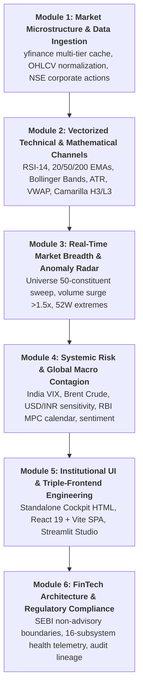

# Alkame NIFTY 50: Applied Quantitative Market Intelligence & Financial Engineering

<div align="center">


### *The Complete Hands-On Masterclass in Institutional Market Analytics, Real-Time Data Ingestion, Risk Telemetry, and Quantitative Dashboards*

[Course Overview](#-course-curriculum) • [Architecture](#-production-system-architecture) • [Hands-on Labs](#-interactive-laboratories--frontends) • [API Guide](#-rest-api-documentation) • [Quickstart](#-hands-on-quickstart) • [SEBI Compliance](#-regulatory-charter--compliance)

---

</div>

> [!IMPORTANT]
> ### ⚖️ Statutory Legal & Non-Advisory Notice
> **This repository and curriculum are strictly for academic, educational, and quantitative engineering research.**  
> In compliance with **SEBI (Research Analysts) Regulations, 2014** and **SEBI (Investment Advisers) Regulations, 2013**:
> - Alkame-Nifty50 **does NOT** provide investment advice, trading tips, or financial recommendations.
> - Alkame-Nifty50 **does NOT** issue directional `BUY` or `SELL` trade calls, price targets, or algorithmic stop-loss recommendations.
> - All outputs, visual corridors, pivot levels, and technical indicators are mathematical computations derived purely from publicly available historical data and regulatory filings.
> - Any directional predictive modeling or machine learning weight sets are strictly quarantined locally for offline computational research (`_local_research/`) and are never distributed or served publicly.

---

## 🎓 Why This Course Platform?

Building production-grade financial software requires a deep mastery of high-frequency data pipelines, mathematical indicator design, event classification, systemic risk modeling, and full-stack dashboard architecture. 

Most tutorials teach toy scripts that fail in real market conditions: they suffer from lookahead bias, break when APIs rate-limit, ignore regulatory compliance, and lack proper error-handling.

**Alkame-Nifty50 is an end-to-end, production-ready educational blueprint** that teaches you how institutional desks build financial intelligence platforms for India's benchmark **NIFTY 50** equities.

---

## 📚 Course Curriculum



### Module 1: Market Microstructure & Resilient Ingestion
- Real-time OHLCV streaming for all 50 NIFTY constituent equities (`data_fetcher.py`).
- Building multi-tier memory and disk caching with automatic rate-limit backoff.
- Ingesting NSE regulatory disclosures, corporate actions, and board meetings (`corporate_events_fetcher.py`).
- Handling market holidays, trading sessions, and calendar boundary anomalies (`market_calendar.py`).

### Module 2: Vectorized Indicator Pipelines & Mathematical Channels
- Strict no-lookahead indicator calculation (`feature_engineer.py`).
- Computing momentum (RSI-14), multi-timeframe moving averages (EMA 20, EMA 50, SMA 200).
- Volatility bands (Bollinger Bands %B and Bandwidth, Average True Range).
- Volume-Weighted Average Price (VWAP) intraday anchors.
- Mathematical pivot theory: Camarilla resistance/support corridors (H3, H4, L3, L4) and Classical Floor Pivots (`reference_level_engine.py`).

### Module 3: Real-Time Universe Breadth & Momentum Radar
- Scanning all 50 NIFTY constituents concurrently on configurable cadences (`insights_engine.py`).
- Volume anomaly detection: identifying stocks trading at $>1.5\times$ their 20-day average volume.
- Measuring advance/decline ratios and sector distribution across the index.
- 52-week high and low proximity analysis.

### Module 4: Systemic Risk & Macro Contagion Modeling
- Tracking macro risk drivers: India VIX, Brent Crude Oil, US Dollar Index, and USD/INR (`global_risk_monitor.py`).
- Macroeconomic calendar tracking RBI Monetary Policy Committee (MPC) repo decisions, inflation data, and Union Budget schedules (`macro_calendar.py`).
- Multi-source financial news sentiment extraction and polarity scoring (`news_sentiment_fetcher.py`).

### Module 5: Triple-Frontend Financial UI Architecture
- **Institutional Cockpit HTML** (`alkame_dashboard.html`): High-refresh, zero-build trading desk cockpit with canvas chart streaming, high-contrast Dark/Light mode, and audio alerts.
- **Modern React 19 SPA** (`frontend/`): Responsive, modular Vite 6 frontend with Tailwind CSS, Lucide icons, and real-time polling.
- **Streamlit Analytics Studio** (`app.py`): Interactive Python workspace for rapid statistical exploration and data filtering.

### Module 6: Enterprise Architecture & Regulatory Compliance
- Designing financial APIs around **SEBI RA/IA regulatory guidelines**.
- Enforcing non-advisory boundaries: replacing speculative recommendations with factual telemetry.
- Building a 16-subsystem health diagnostic matrix with Prometheus metrics (`health_monitor.py`).
- Immutable audit ledger tracking cryptographic hashes for reproducible quantitative research (`history_manager.py`).

---

## 🏛️ Production System Architecture

```
alkame-nifty-50-educational/
│
├── 🚀 BACKEND SERVICES & APIS
│   ├── api.py                      # FastAPI REST Layer with Swagger/OpenAPI docs
│   ├── api_schemas.py              # Pydantic Schemas for type-safe validation
│   ├── config.py                   # Central Configuration & SEBI Compliance Mode
│   ├── insights_engine.py          # Unified Market Intelligence & Breadth Engine
│   ├── prediction_types.py         # Neutral Educational Data Contracts
│   ├── predictor.py                # Educational Posture & Reference Level Predictor
│   ├── scheduler.py                # Automated Market Hours Background Orchestrator
│   └── database.py                 # SQLite / SQLAlchemy Persistence Layer
│
├── 📊 MARKET DATA & INGESTION ENGINES
│   ├── data_fetcher.py             # Multi-Tier Data Ingestion Engine with Cache
│   ├── corporate_events_fetcher.py # NSE Announcements & Corporate Actions Scraper
│   ├── macro_calendar.py           # RBI Repo Corridor & Macro Event Scheduler
│   ├── global_risk_monitor.py      # Systemic Contagion Engine (VIX, Crude, USD/INR)
│   ├── news_sentiment_fetcher.py   # Audited Financial News RSS & Sentiment Parser
│   ├── reference_level_engine.py   # Camarilla & Classical Pivot Mathematical Models
│   └── sector_provider.py          # NIFTY 50 Sector Taxonomy & Weightings
│
├── 💻 INTERACTIVE USER INTERFACES
│   ├── alkame_dashboard.html       # Standalone Dual-Theme Institutional Cockpit
│   ├── app.py                      # Streamlit Quantitative Analytics Studio
│   └── frontend/                   # Modern React 19 + Vite 6 Single Page Application
│       ├── src/components/
│       │   ├── StockInsightsCard.jsx   # Technical Snapshot & Filings Card
│       │   └── MarketBreadthPanel.jsx  # Universe Volume & Momentum Radar
│       └── package.json
│
├── 🔬 QUANTITATIVE NOTEBOOKS & JUPYTER LAB
│   └── data_analyst/
│       ├── notebooks/
│       │   ├── 01_calibration_reliability.ipynb # Probability Calibration Studies
│       │   ├── 02_backtest_sector_comparison.ipynb # Cross-Sector Momentum Analysis
│       │   └── 03_event_impact_study.ipynb      # Corporate Announcement Alpha Impact
│       └── seed_sample_data.py
│
└── 🧪 AUTOMATED TEST SUITE
    ├── tests/test_insights_engine.py          # Core Market Insights Engine Tests
    ├── tests/test_dashboard_api_endpoints.py  # API Contract & Schema Verification
    └── tests/test_app.py                      # Streamlit UI Integration Tests
```

---

## 🖥️ Interactive Laboratories & Frontends

### 1. Institutional Cockpit HTML (`alkame_dashboard.html`)
The crown jewel of the platform — open directly in any browser with **zero npm dependencies**:
- **Regime Posture Gate**: Descriptive summary of RSI, volume ratio, and Camarilla channels.
- **Multi-Timeframe Technical Matrix**: Intraday to multi-week moving average alignments.
- **Live Market Stream Canvas**: Real-time price ticks charted within dynamic VWAP and Camarilla bounds.
- **Intraday Volume Radar**: Real-time constituent sorting tracking volume anomalies ($>1.5\times$ 20D average).
- **16-Subsystem Health Telemetry**: Live status monitoring data latency, SQLite connectivity, and cache freshness.
- **Dual-Theme High Contrast**: Switch between Day and Night trading desk modes with one click.

### 2. Modern React 19 + Vite SPA (`frontend/`)
Clean, modular front-end component architecture:
- [`StockInsightsCard.jsx`](file:///c:/Users/user/Desktop/alkameinc/alkame-nifty-50-educational/frontend/src/components/StockInsightsCard.jsx): Clean card displaying technical indicators, Camarilla support/resistance levels, valuation metrics, and corporate filings.
- [`MarketBreadthPanel.jsx`](file:///c:/Users/user/Desktop/alkameinc/alkame-nifty-50-educational/frontend/src/components/MarketBreadthPanel.jsx): Real-time constituent radar with volume surge badges, RSI status, and 52-week proximity.
- Real-time background synchronization with automatic API failover.

### 3. Streamlit Analytics Studio (`app.py`)
Perfect for interactive desktop research and rapid prototyping:
- Select any of the 50 NIFTY constituent stocks from the sidebar.
- Inspect detailed valuation metrics, moving average posture, and corporate announcements.
- View interactive candlestick charts and historical snapshots.

---

## ⚡ Hands-On Quickstart

### Step 1: Clone & Initialize Virtual Environment
```bash
# Clone the repository
git clone https://github.com/Alkameinc/alkame-nifty-50-educational.git
cd alkame-nifty-50-educational

# Create Python virtual environment
python -m venv venv

# Activate virtual environment
# Windows:
.\venv\Scripts\activate
# Linux/macOS:
source venv/bin/activate

# Install dependencies
pip install -r requirements.txt
```

### Step 2: Start the FastAPI Backend & Launch Cockpit
```bash
python -m uvicorn api:app --host 127.0.0.1 --port 8000 --reload
```
Once running:
- **Cockpit Dashboard**: Open [`http://127.0.0.1:8000/dashboard`](http://127.0.0.1:8000/dashboard) in your browser.
- **Interactive API Documentation**: Open [`http://127.0.0.1:8000/docs`](http://127.0.0.1:8000/docs) (Swagger UI).

### Step 3: Run the React 19 Frontend (Optional)
```bash
cd frontend
npm install
npm run dev
```
Open [`http://localhost:3000`](http://localhost:3000) to view the React application.

### Step 4: Run the Streamlit Studio (Optional)
```bash
streamlit run app.py
```
Open [`http://localhost:8501`](http://localhost:8501) in your browser.

---

## 📡 REST API Documentation

| Method | Endpoint | Description |
|---|---|---|
| `GET` | `/api/v1/insights/{symbol}` | **Primary Intelligence Feed**: Factual RSI-14, 20/50/200 EMAs, Camarilla levels, valuation multiples, corporate filings, macro context, and news sentiment. |
| `GET` | `/api/v1/market-breadth` | **Universe Radar**: Scans all 50 NIFTY constituents for volume surges ($>1.5\times$ 20D SMA), advances/declines, and 52W proximity. |
| `GET` | `/api/v1/fundamentals/{symbol}` | Valuation multiples, market capitalization, 52-week ranges, and sector classification. |
| `GET` | `/api/v1/symbols` | List of 50 active NIFTY index constituent symbols. |
| `GET` | `/api/v1/chart/{symbol}` | OHLCV historical candlestick data formatted for charting. |
| `GET` | `/api/v1/health` | Comprehensive 16-subsystem health diagnostic matrix. |
| `GET` | `/api/v1/risk/reading` | Global risk monitor reading (India VIX, Crude Oil, USD/INR). |
| `GET` | `/api/v1/scalping` | Educational notice directing consumers to `/api/v1/market-breadth`. |
| `GET` | `/dashboard` | Serves the standalone Institutional Cockpit HTML application. |

---

## 🧪 Automated Testing & Verification

Run the test suite to verify analytical computations and API contract compliance:
```bash
# Run core test suite
python -m pytest tests/test_insights_engine.py tests/test_dashboard_api_endpoints.py tests/test_app.py -v

# Run React build verification
cd frontend && npm run build
```

---

## 🔬 Local Research Isolation

In strict compliance with open-source and regulatory boundaries, proprietary machine learning models, training scripts, and backtesters are **quarantined locally in `_local_research/`**:
- Model artifacts (`models/*.joblib`, `models/*.pkl`, `models/*.json`) are excluded in `.gitignore`.
- Algorithmic research scripts (`model_trainer.py`, `backtester.py`, `scalping.py`, `ensemble_manager.py`) are maintained in `_local_research/` for offline mathematical experimentation.
- The public codebase remains 100% self-contained and operational as an informational market intelligence platform.

---

## 🤝 DBERT AI Internship Program

This platform is developed as a flagship capstone for the **DBERT AI Internship Program**.
- **Official Portal**: [https://internship.dbert.online](https://internship.dbert.online)
- **Organization**: [https://dbert.online](https://dbert.online)
- **Domain**: Quantitative Finance, Financial Engineering & Full-Stack Data Analytics

---

## 📄 License

This repository is licensed under the Apache 2.0 License. See the [LICENSE](LICENSE) file for complete details.
